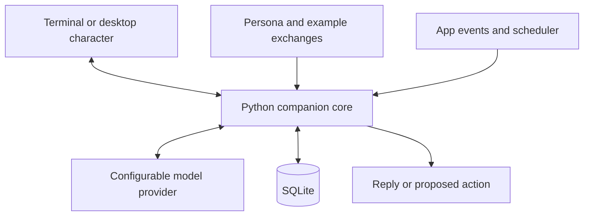

# Personal AI companion — phased project plan

Use this as a menu of milestones. Each phase has a working stopping point. The first implementation session can end after a single terminal conversation survives a restart.

## Architecture

Keep the core callable from Python before introducing a web server. The core reads the persona and selected context, asks the model for a reply, and returns it to the interface. Add storage and action handling as the corresponding features arrive. Keep the model name and credentials in configuration, with keys outside source control. The provider is DeepSeek with `deepseek-flash` (originally planned as Groq with `qwen/qwen3.8-27b`). Keep a model switch in configuration.

Python is the chosen implementation language, not a technical requirement for the concept. It can handle terminal chat and the desktop character. PySide6 supplies the desktop window and animations, so this plan does not require Rust. Begin on Linux only. Later, add a shared backend for Windows access, then a phone client that connects to the same backend.

## Phase 1 — Terminal chat

- Create a small Python CLI with one provider call and a readable error when the key is missing, the network is down, or the quota is reached.
- Load a basic persona file. Store the conversation and ordered messages in SQLite. Support starting a new conversation and reopening the last one.
- Send a bounded window of recent messages. Use a fake provider or stubbed response to check the restart flow without spending API requests.
- Record setup steps, Python version, and the command to launch the app. Verify this sprint on Linux only.

**Done when** you can chat, quit, relaunch, and continue the same conversation. The CLI can show a provider failure without losing your saved history.

## Phase 2 — Tune the personality and add memory

- Rewrite `persona/mochi.md` from the temporary persona profile and the owner-written calibration examples (01–13, with 03 and 10 held out for testing). Voice: lowercase, terse, dry, profanity by default, `e`/`a` pronouns (`t`/`m` only in emphatic banter), one Bubble per line, text-only (never emit image markers). Drop the soft "em/anh" voice and the Pygmalion coaching rule. Drop profanity and the edge when the user is vulnerable, and ask "vent or make a plan" when distress is unclear. Cap the Persona at about 2,500 tokens and warn at startup if it is over.
- Add commands: `/remember #tag text` (Stated), `/memories`, `/edit <id> text`, `/tag <id> #a #b`, `/forget <id>` (hard delete), `/confirm <id>` (Observed becomes Stated). Editing an Observed Memory also makes it Stated. Ids are stable and never reused. Memories are stored in SQLite.
- Mochi proposes an Observed Memory with a final line `[observe: tags=a,b | text]`. Mochi voices the observation tentatively in the same reply, as a question (calibration 13 B). The CLI strips the marker, saves it as Observed, and prints a `/confirm` or `/forget` prompt. At most one proposal per reply, duplicates are skipped, and a malformed marker is dropped silently. Unconfirmed Observed Memories are injected with hedged wording.
- Inject Memories in a separate block of up to about 400 tokens. While all Memories fit, inject all. Beyond that, select the top 5 by Tag and keyword score, ties by recency, with `#core` always included (count is configurable).
- Add `scripts/compare_models.py`: a committed prompt set run against one or more models on DeepSeek, written as side-by-side Markdown. Judge EN/VI switching, consistency, venting, and recall by hand, and copy good exchanges into the Persona.
- Fine-tuning is out of scope for this phase.

**Done when** Mochi feels recognizable across several sessions, recalls a saved preference after restart, and honors your edits and deletions.

## Phase 3 — Put the character on the desktop

- Build a small floating, transparent window with PySide6. Prototype with placeholder sprites before drawing the final character. The Python desktop UI calls the existing companion core.
- Start with idle, thinking, and replying states. Click the character to open a compact chat panel. Add drag, hide, and restore controls. Let the app remember its position.
- Drive animation from app state. A model request can trigger thinking, and a completed reply can trigger the reply animation. Keep window management and animation outside the chat logic.
- Try transparency, dragging, always-on-top, scaling, and multi-monitor placement on the actual Linux desktop early. Wayland compositors can control window position and stacking differently. Use a regular small window as a fallback if the floating overlay is limited. Recheck these behaviors on Windows when that client is added.

**Done when** the Linux desktop character and terminal use the same chat and memory, and the character stays usable without getting in your way.

## Phase 4 — Add tasks and study sessions

- Implement basic task creation, listing, editing, and completion as ordinary app operations. Start with title, status, and optional due time. Add parent and child relationships when task breakdown needs them.
- Add a simple focus session. Pick a task, start a timer, and record whether you started, finished, or skipped it. Offer a check-in and snooze.
- Persist scheduled times and define what happens when the app restarts or the laptop sleeps through a reminder. Deliver one overdue reminder or mark it missed according to your chosen rule.
- Show active and due tasks in the chat panel. Make the basic task controls usable even when the model API is unavailable.

**Done when** you can create a task, run a focus session, receive a check-in, and find the outcome after restarting.

## Phase 5 — Give it tools and bounded initiative

- Start with one useful ability. Given a vague task, the model proposes a short breakdown and one first action. The app previews the steps and saves them if you accept.
- Give the model only a few named actions such as `list_tasks`, `propose_subtasks`, and `propose_check_in`. Python validates arguments and checks task IDs, dates, and current state before carrying anything out. Start with user confirmation for writes.
- Make initiative event-driven. A timer ending, a task becoming due, or a session being skipped can trigger a decision to speak, show a silent animation, or do nothing. You choose enabled events, quiet hours, and a cooldown. One timer event should produce at most one check-in.
- Use rules for common timing and eligibility decisions. Ask the model for wording or a next-step suggestion only when needed. Keep a visible record of actions so you can tell what it did and why.
- Use outcomes to propose editable memories. If ten-minute starts seem to help, suggest the observation and cite the sessions behind it. Let you accept, reject, or revise it.

**Done when** the companion can turn “help me get started on this GDD section” into a useful proposal and later check in on an approved schedule. You can pause proactive behavior from the UI.

## Phase 6 — Give it a voice

- Start with optional text-to-speech for selected replies. Add mute and stop controls and hook playback into the character’s speaking animation. Try device voices first. If one recognizable voice matters across devices, choose one speech engine that generates audio for each client to play.
- Add push-to-talk. Record a short clip, send it to a transcription provider such as Groq Whisper or use a local speech recognizer, then pass the transcript to the existing chat flow. Keep the transcript visible so you can catch errors.
- Try real English/Vietnamese mixes and proper names from your projects. Check that quiet hours and mute apply to proactive speech, too.
- Treat continuous listening, interruptions mid-reply, and live voice calls as separate scope choices.

**Done when** you can ask a spoken question, see its transcript, hear an in-character reply, and stop playback immediately.

## Scope decisions to take to Claude

| Decision | Smallest useful scope | Expansion |
|---|---|---|
| Platform | Linux terminal first, then a Linux PySide6 character | Add a Windows client after the Linux experience works |
| Data | One SQLite database on your primary machine | Shared backend for multiple installations and Android access |
| Personality | Prompt, examples, editable memory | Compare models or run an actual fine-tuning experiment |
| Initiative | Opt-in study timer check-ins | More event types, quiet hours, and action proposals |
| Voice | Spoken replies | Push-to-talk, a consistent character voice, or live conversation |
| Android | A later browser client with shared chat history | Background notifications, including when the laptop is off, with an online backend |

If you add sync, keep one authoritative database behind the backend. Decide separately whether the laptop can host it or whether you need an always-online host for mobile check-ins. Store the API key on the backend and authenticate any access from outside the machine. When using a hosted chat or transcription provider, send the minimum context or audio needed for that request.

For Windows sync, expose the existing Python core through an authenticated FastAPI service, with one server-owned database. The Windows client can begin as a terminal client and later use PySide6 for its own desktop character. For phone sync, add a responsive web client that calls the same API. If Linux and Windows are dual-boot installations on one laptop, a server running only in Linux will be offline while Windows is booted, so decide where the shared backend will run before promising seamless sync.

For the first Claude session, give it the brief and the phase-one section. Ask it to implement the CLI, configurable model connection, basic persona loading, and restartable chat history. Use the phase-one completion check to decide whether to move on to tuning.
